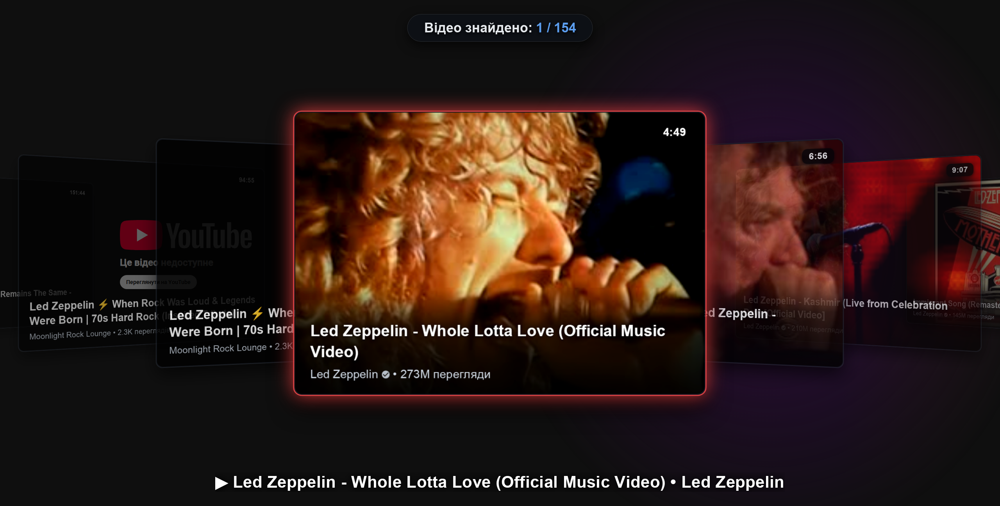
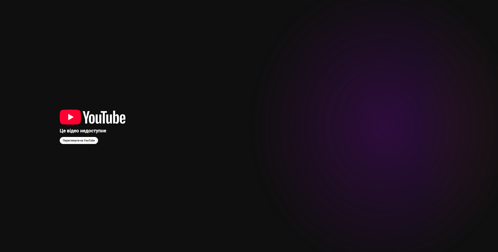
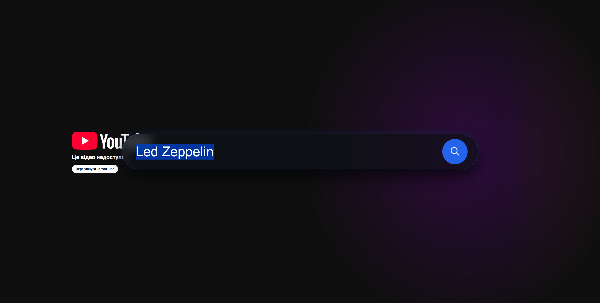

<div align="center">
  
  <h1>Dushin Invidious</h1>
  <p><b>Альтернативний клієнт із відкритим вихідним кодом для YouTube з 3D Cover Flow та режимом кінотеатру</b></p>

  <a href="https://www.gnu.org/licenses/agpl-3.0.en.html">
    
  </a>
  <a href="https://github.com/AndriyVeremchuck/invidious/commits/master">
    
  </a>
</div>

---

## 📌 Про цей форк: що було змінено, додано та навіщо

Цей проєкт є персональним форком офіційного [iv-org/invidious](https://github.com/iv-org/invidious).

**Головна мета форку** — перетворити стандартний вебінтерфейс Invidious на ультрашвидку, візуально вишукану та безрекламну музичну відеостанцію формату **"розумне радіо" (Edge Cinema & Cover Flow)**, якою однаково зручно користуватися як на комп'ютері з клавіатури чи миші, так і на Smart TV з пульта або на смартфонах і планшетах Android.

### 🌟 Ключові зміни та нові можливості:

1. **3D Cover Flow барабан станцій**:
   - Інтерактивне гортання карток станцій у тривимірному просторі з апаратним прискоренням GPU (`CSS 3D Transforms: translate3d, rotateY, scale, perspective`).
   - Наближена відстань між картками, відсутність зайвих круглих кнопок та візуального сміття — чисті насичені постери з бейджем тривалості та неоновим підсвічуванням поточної пісні.
2. **Edge Cinema Mode (Чистий кінотеатр)**:
   - Відео розгортається на весь екран без банерів, коментарів, зайвих блоків та відволікаючих рекомендацій.
   - Інтелектуальне автоприховування: якщо користувач не рухає курсор, інтерфейс автоматично плавно зникає через **1.65 с**, залишаючи тільки чисте відео. При вході курсору в центральну зону інтерфейс миттєво повертається.
3. **Швидкісний паралельний пошук та безшовне фонове довантаження**:
   - При введенні запиту система паралельно запитує перші 8 сторінок YouTube (160+ станцій), сортує їх за спаданням переглядів (найпопулярніші хіти завжди першими) та автоматично запускає трек №1.
   - Фонове розширення (сторінки 9–25 та схожі радіо-мікси) непомітно додає до 350+ станцій у пам'ять без перезавантаження DOM і без найменшого блимання, перетасування чи зміщення поточних карток (`appendItems`).
4. **Система вибраного (Favorites)**:
   - Миттєве додавання пісні у вибране клавішами `Insert` або `+` / `=`.
   - Видалення з вибраного клавішами `Delete` або `-`.
   - Станції, які вже додані до вибраного, автоматично фільтруються із загального барабана пошуку, щоб не дублювати треки.
5. **Професійна клавіатурна навігація**:
   - `PageDown` / `PageUp` — миттєвий стрибок на 100 станцій вперед або назад.
   - `Home` / `End` — швидкий перехід до найпершого або останнього треку списку.
   - `ArrowLeft` / `ArrowRight` — плавний поворот барабана станцій з захистом від випадкового перескакування.
   - Коліщатко миші з інтелектуальним накопичувачем імпульсу (аккумулятором).
6. **Оптимізація під Android та великі екрани**:
   - Автоматичне розпізнавання платформи Android (`.is-android`) зі зменшенням розміру шрифтів у картках на **30%** для компактного й гармонійного вигляду на смартфонах та емуляторах.
   - Динамічне адаптивне масштабування під екрани будь-якої діагоналі (від 40" UltraWide / 4K TV до ноутбуків і смартфонів).
7. **Повноцінний доступ через локальну мережу (IP)**:
   - Сервіс прив'язаний до `0.0.0.0:3000`, що дозволяє транслювати музику та відкривати плеєр на будь-якому телефоні, планшеті чи домашньому телевізорі в одній мережі Wi-Fi.

---

## 📸 Скриншоти інтерфейсу

### 1. Повноекранне відтворення відео (Pure Cinema Mode)
> Чистий повноекранний перегляд без реклами, коментарів та сторонніх відволікань.



---

### 2. Верхня панель пошуку та меню
> Розумний Omnibox-пошук з автовиділенням тексту, фільтрами та миттєвим пошуком станцій.



---

### 3. Інтерактивний 3D Cover Flow барабан карток
> Преміальний 3D-карусельний барабан станцій із фізикою руху, лічильником композицій та акцентним центром.


---

## 🛠️ Стек технологій

У проєкті використано високоефективні сучасні інструменти з відкритим кодом:

- **[Crystal](https://crystal-lang.org/)** ([GitHub](https://github.com/crystal-lang/crystal)) — високоефективна скомпільована мова програмування нового покоління із синтаксисом Ruby та швидкістю виконання на рівні C/C++.
- **[Kemal](https://kemalcr.com/)** ([GitHub](https://github.com/kemalcr/kemal)) — блискавичний, надлегкий вебфреймворк для Crystal, що забезпечує мікросекундну швидкість обробки HTTP-запитів.
- **[Invidious Core & Companion](https://invidious.io/)** ([GitHub](https://github.com/iv-org/invidious)) — безпечний бекенд для взаємодії з медіапотоками без використання пропрієтарних API Google, реклами та систем стеження.
- **[PostgreSQL](https://www.postgresql.org/)** ([GitHub](https://github.com/postgres/postgres)) — потужна реляційна база даних корпоративного рівня для надійного збереження підписок, історії та налаштувань.
- **[Vanilla JavaScript & Modern CSS 3D](https://developer.mozilla.org/en-US/docs/Web/CSS/transform-function/rotateY)** — ядро інтерфейсу написане на чистому JavaScript без важких фреймворків; 3D-трансформації каруселі працюють через нативне апаратне прискорення відеокарти (GPU) для досягнення стабільних 60 FPS.
- **[Docker & Docker Compose](https://www.docker.com/)** ([GitHub](https://github.com/docker/compose)) — ізольована контейнеризація для легкого розгортання та роботи на будь-якому сервері, ПК чи одноплатному комп'ютері (Raspberry Pi тощо).

---

## 🎯 Підсумок

**Dushin Invidious** створений для тих, хто цінує свій час, приватність та естетику:
- **Жодної реклами та стеження**: пряме відтворення аудіо та відео без трекерів Google.
- **Естетика та кінематографічність**: плавний 3D Cover Flow барабан і автоприховування інтерфейсу повертають насолоду від перегляду та прослуховування музики.
- **Швидкість**: моментальний пошук сотень станцій, відсортованих за якістю й популярністю.
- **Універсальність**: однаковий комфорт при роботі з клавіатури ПК, пульта телевізора чи сенсорного екрана смартфона.

---

## 🚀 Як зібрати та запустити

### Вимоги:
- Встановлені **[Docker](https://docs.docker.com/get-docker/)** та **[Docker Compose](https://docs.docker.com/compose/install/)**.

### Покрокова інструкція:

1. **Клонуйте репозиторій**:
   ```bash
   git clone https://github.com/AndriyVeremchuck/invidious.git
   cd invidious
   ```

2. **Запустіть сервіси через Docker Compose**:
   ```bash
   docker compose up -d
   ```
   *Команда автоматично завантажить потрібні образи (PostgreSQL, Companion, Invidious) та підніме сервіси у фоновому режимі.*

3. **Перевірте стан контейнерів**:
   ```bash
   docker compose ps
   ```

4. **Відкрийте у браузері**:
   - **На поточному комп'ютері**: [http://localhost:3000](http://localhost:3000)
   - **З будь-якого пристрою у локальній Wi-Fi мережі** (телефон, планшет, Smart TV):  
     `http://<ВАША_IP_АДРЕСА>:3000`  
     *(наприклад: `http://192.168.1.103:3000`)*

---

### 🔧 Корисні команди для керування:

- **Переглянути логи в реальному часі**:
  ```bash
  docker compose logs -f invidious
  ```
- **Перезапустити проєкт**:
  ```bash
  docker compose restart
  ```
- **Зупинити роботу**:
  ```bash
  docker compose down
  ```
- **Оновити файли інтерфейсу після змін**:
  ```bash
  docker cp assets/js/edge_cinema.js invidious-invidious-1:/invidious/assets/js/edge_cinema.js
  docker cp assets/css/default.css invidious-invidious-1:/invidious/assets/css/default.css
  docker restart invidious-invidious-1
  ```

---

## 📄 Ліцензія

Цей проєкт поширюється за вільною ліцензією **GNU Affero General Public License v3.0 (AGPL-3.0)**.  
Детальніше у файлі [LICENSE](./LICENSE).
